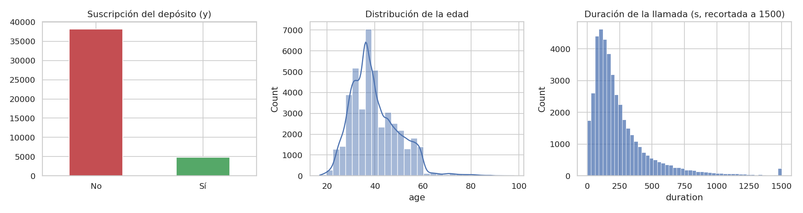
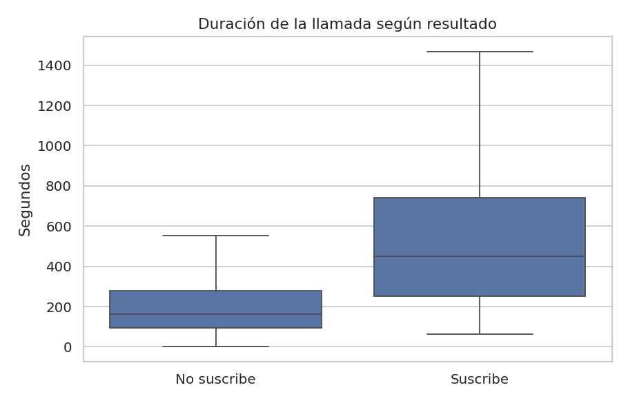
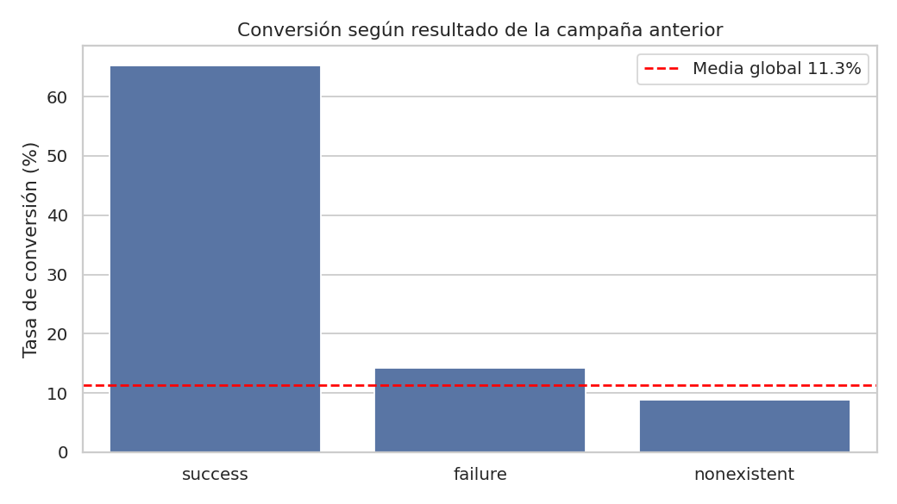
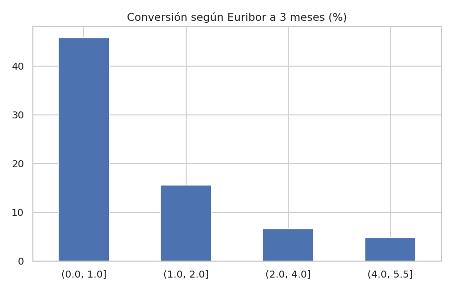
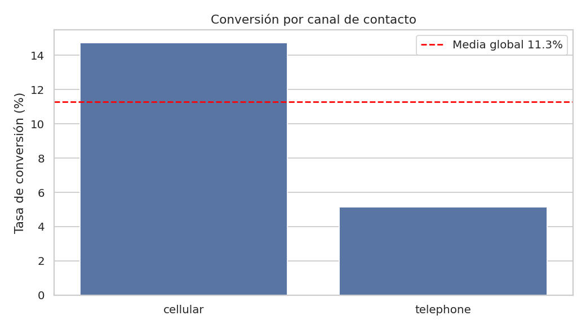
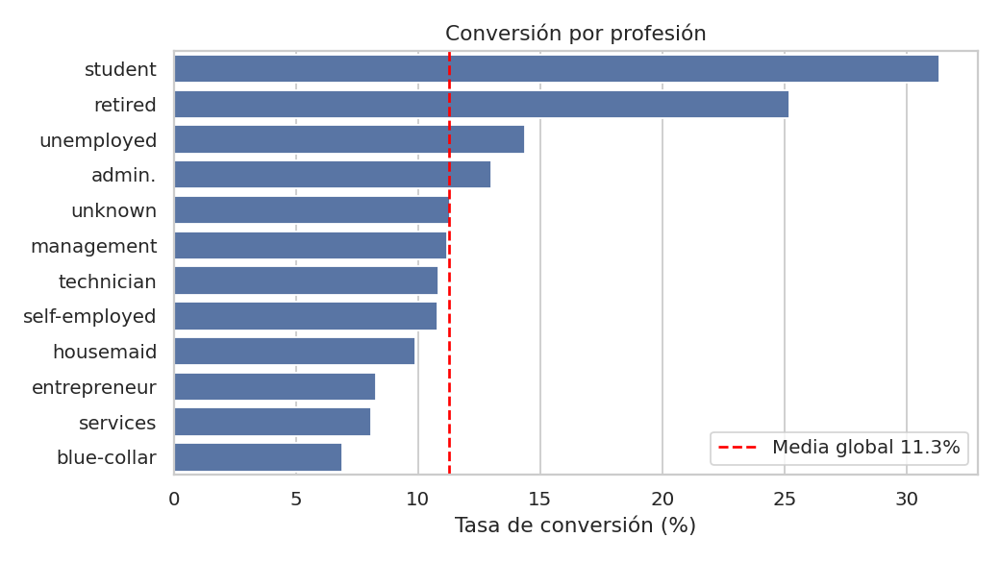
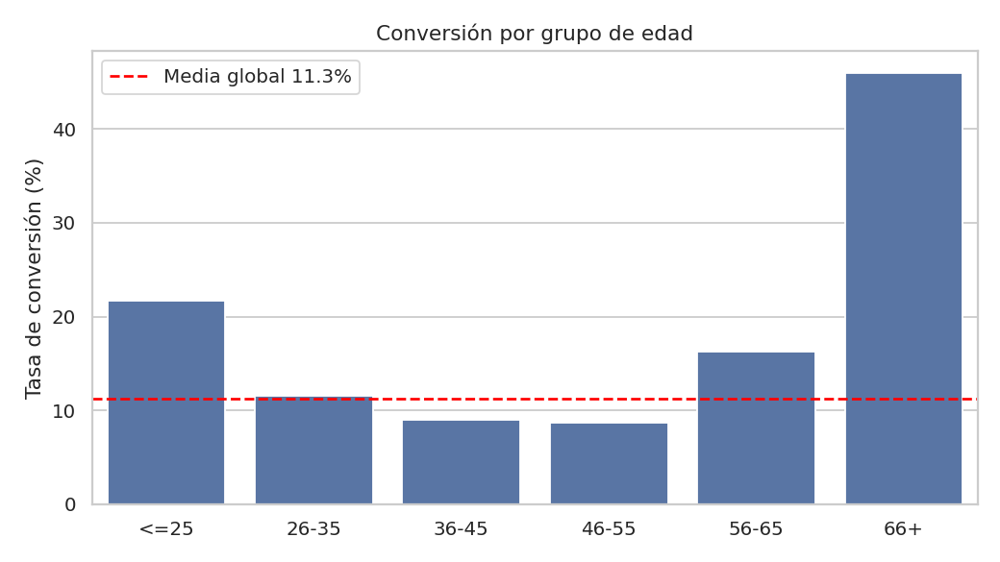
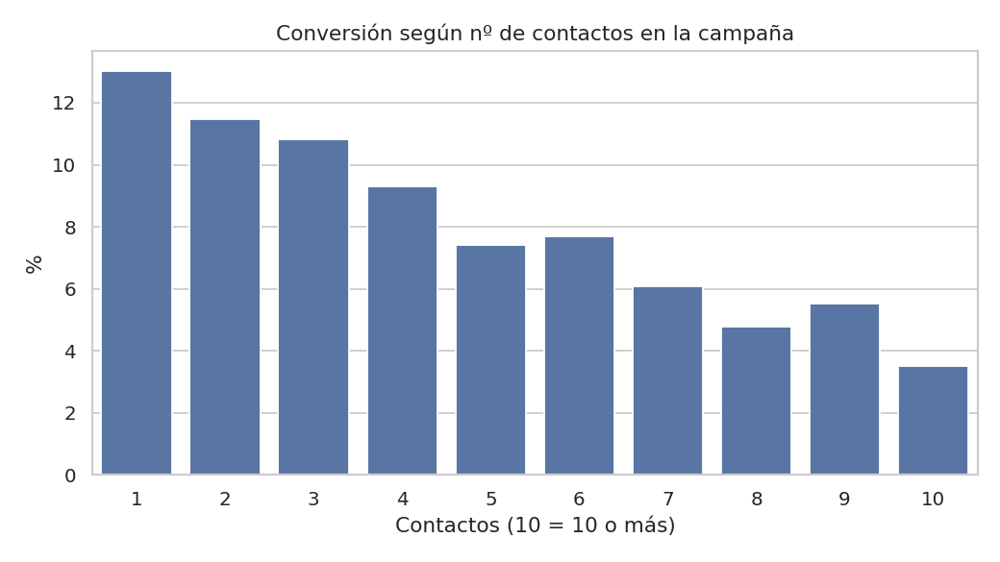
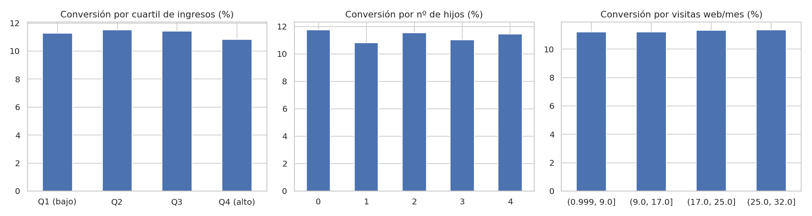

# Análisis exploratorio de campañas de marketing bancario (depósito a plazo)

Proyecto EDA con Python y pandas sobre campañas telefónicas de una entidad bancaria portuguesa. El objetivo es entender **qué factores se asocian a que un cliente suscriba un depósito a plazo** (variable `y`) y proponer recomendaciones accionables.

## Estructura del repositorio

```
├── data/
│   ├── raw/            # Datos originales sin tocar (CSV, Excel, enunciado)
│   └── processed/      # Datos tras la limpieza (bank_clean.csv, bank_customers_merged.csv)
├── src/
│   ├── cleaning.py     # Limpieza, transformación y cruce de datasets
│   └── analysis.py     # Estadísticos descriptivos, contrastes y gráficos
├── figures/            # Gráficos generados (PNG)
├── reports/            # Salida completa del análisis en texto
├── requirements.txt
└── README.md
```

## Cómo ejecutarlo

```bash
pip install -r requirements.txt
python src/cleaning.py    # genera data/processed/*.csv
python src/analysis.py    # genera figures/*.png e imprime las tablas
```
Los scripts usan rutas relativas a la raíz del repositorio, por lo que funcionan desde cualquier directorio (probados con Python 3.12 / pandas 2.x+).

---

## 1. Datos de partida

| Fichero | Contenido | Filas |
|---|---|---|
| `bank-additional.csv` | Contactos de la campaña (perfil, llamada, contexto macro, resultado) | 43.000 |
| `customer-details.xlsx` | Ingresos, hijos, visitas web y fecha de alta. 3 hojas (2012, 2013, 2014) | 20.115 + 8.965 + 14.090 = 43.170 |

## 2. Transformación y limpieza

Problemas detectados y decisión tomada (todo implementado en `src/cleaning.py`):

| Problema | Detalle | Tratamiento |
|---|---|---|
| Decimales con coma | `cons.price.idx`, `cons.conf.idx`, `euribor3m`, `nr.employed` se leían como texto (`"93,994"`) | Sustitución `,`→`.` y conversión a `float` |
| Fechas en español | `"14-septiembre-2016"` | Diccionario de meses → `datetime`; se crean `contact_month` y `contact_year` (descritas en el enunciado pero ausentes del CSV) |
| Mayúsculas inconsistentes | `MARRIED`, `NONEXISTENT`… frente a `admin.`, `cellular` | Todo a minúsculas y `strip()` |
| Columna residual | `Unnamed: 0` (índice de exportación) en el CSV y en las 3 hojas | Eliminada |
| Nulos en categóricas | `job` (345), `marital` (85), `education` (1.807), `default` (8.981), `housing`/`loan` (1.026) | Se codifican como `unknown`: se conserva la información de que no se conoce y no se pierden filas |
| Nulos en `age` | 5.120 (11,9%) | Mediana de edad por profesión + columna `age_imputada` para trazabilidad. La tasa de nulos es igual en suscriptores y no suscriptores (11,9% en ambos), así que no hay sesgo evidente |
| Nulos en macro | `euribor3m` (9.256), `cons.price.idx` (471) | Mediana del grupo con igual `(emp.var.rate, nr.employed, cons.conf.idx)`: son indicadores del periodo y esas filas comparten valores casi idénticos. **Limitación:** el Euribor varía dentro de cada grupo, por lo que la imputación suaviza algo su variabilidad |
| `pdays = 999` | Código centinela para "nunca contactado" (41.412 filas) | Se convierte en `NaN` y se crea `contactado_antes` (0/1). Dejarlo como 999 habría distorsionado media y correlaciones |
| `date` nula | 248 filas | No imputable de forma fiable (ver §6): se dejan como nulo |
| Variable objetivo | `yes`/`no` | `1`/`0` |
| Excel en 3 hojas | Una por año | Concatenadas en un único DataFrame |
| Cruce de datasets | `id_` (CSV) = `ID` (Excel) | `merge` con `validate="one_to_one"`: **43.000 de 43.000 cruzan**; hay 170 clientes del Excel sin contacto en la campaña, que se descartan en el cruce |

Comprobaciones de integridad pasadas: 0 duplicados de `id_`, 0 clientes con la hoja incoherente con su año de alta, 0 contactos anteriores a la fecha de alta del cliente.

Variables derivadas: `grupo_edad`, `duration_min`, `contactado_antes`, `Hijos_total`, `tramo_ingresos` (cuartiles).

## 3. Análisis descriptivo

**Conversión global: 11,27 %** (4.844 de 43.000). Clases desbalanceadas (≈ 1 de cada 9).

| Variable | Media | Mediana | Desv. típ. | Asimetría |
|---|---|---|---|---|
| age | 39,8 | 38 | 10,0 | 0,88 |
| duration (s) | 257,7 | 179 | 258,7 | 3,32 |
| campaign | 2,57 | 2 | 2,77 | 4,77 |
| Income | 93.241 | 93.050 | 50.498 | 0,00 |
| NumWebVisitsMonth | 16,6 | 17 | 9,2 | −0,01 |

- `duration` y `campaign` tienen colas largas a la derecha (media muy por encima de la mediana): hay un 7,1 % de outliers en duración y un 5,8 % en nº de contactos según la regla 1,5·IQR. **Se mantienen** porque son valores plausibles (llamadas largas, clientes insistentes), no errores; al ser asimétricas conviene usar la mediana para describirlas.
- `default` es prácticamente constante: 34.016 "no", 3 "yes" y 8.981 desconocidos. No aporta información discriminante.



## 4. Hallazgos principales

### 4.1 La duración de la llamada es la variable más asociada al éxito… pero no es accionable
Mediana de **449 s** en quienes suscriben frente a **163 s** en quienes no (correlación 0,41, la mayor con `y`). Atención: la duración solo se conoce **después** de la llamada, así que sirve para describir pero **no para predecir ni para decidir a quién llamar** (fuga de información). Cualquier modelo predictivo debería excluirla.



### 4.2 El historial previo del cliente es el mejor predictor accionable
| Resultado campaña anterior | Clientes | Conversión |
|---|---|---|
| success | 1.436 | **65,3 %** |
| failure | 4.461 | 14,2 % |
| nonexistent (primer contacto) | 37.103 | 8,8 % |

La conversión crece con los contactos previos: 8,8 % con 0, 21,1 % con 1, 46,6 % con 2 y ≈ 60 % con 3 o más. Los clientes que ya contrataron antes son una base prioritaria.



### 4.3 El contexto macroeconómico condiciona fuertemente el resultado
Con Euribor 3m ≤ 1 % la conversión es del **45,8 %**; entre 1 y 2 %, 15,7 %; con Euribor > 4 %, **4,8 %**. `nr.employed` (−0,36), `euribor3m` (−0,31) y `emp.var.rate` (−0,30) están entre las correlaciones más fuertes, y entre sí están casi colineales (0,91–0,97), por lo que miden esencialmente el mismo fenómeno: el ciclo económico. Los depósitos resultan mucho más atractivos cuando los tipos son bajos o la economía está en fase de contracción de empleo.

> **Cautela (confusión):** este factor distorsiona otros resultados. Por ejemplo, el 90 % de los contactos en periodos de Euribor ≤ 2 % fueron a móvil, frente al 51 % en periodos de Euribor > 2 %. Por eso hay que comparar siempre *dentro* de cada régimen de tipos (ver 4.4).



### 4.4 Canal: el móvil rinde más, aunque menos de lo que parece
Bruto: **14,7 %** (móvil) frente a **5,2 %** (fijo). Controlando por el régimen de tipos, la ventaja del móvil se mantiene pero se reduce:

| | Euribor ≤ 2 % | Euribor > 2 % |
|---|---|---|
| cellular | 25,1 % | 5,7 % |
| telephone | 18,4 % | 3,9 % |

Parte de la brecha bruta se debe a que el teléfono fijo se usó más en los periodos desfavorables, no solo al canal en sí.



### 4.5 Perfil del cliente
- **Edad en forma de U:** ≤ 25 años 21,7 %, 36-45 años 9,0 %, 46-55 años 8,7 %, 56-65 años 16,3 %, **66+ años 46,0 %**. El patrón persiste dentro de periodos de Euribor ≤ 2 % (p. ej. 66+ = 46 % frente a ≈ 19-24 % en 26-55 años), por lo que no se explica solo por el ciclo. Los mayores de 66 son una muestra pequeña (576).
- **Profesión:** estudiantes (31,3 %) y jubilados (25,2 %) lideran; `blue-collar` (6,9 %) y `services` (8,1 %) son los más bajos. Combinado con canal: estudiantes por móvil 36,4 % y jubilados por móvil 31,4 %; `self-employed` por fijo 3,4 %.
- **Educación:** la conversión es mayor con título universitario (13,7 %) que con `basic.6y` y `basic.9y` (8,1 % y 7,8 %); `basic.4y` queda en 10,3 %.
- **Estado civil:** solteros 13,9 % frente a casados/divorciados 10,2 %.
- **Hipoteca / préstamo:** diferencias mínimas (`housing`: 10,9 % vs 11,6 %; `loan`: sin diferencia significativa, p = 0,61).

 

### 4.6 Insistir tiene rendimientos decrecientes
La conversión cae de **13,0 %** con un solo contacto a **3,5 %** con 10 o más. A partir del 4.º-5.º contacto el rendimiento ya es inferior a la mitad del primero. Conviene fijar un máximo de intentos por cliente y reasignar ese esfuerzo.



### 4.7 Los datos del Excel (ingresos, hijos, visitas web) no discriminan
Ni los ingresos (tasa 10,8-11,5 % en todos los cuartiles; t-test p = 0,33), ni el nº de hijos, ni las visitas web mensuales (p = 0,91) están relacionados con la suscripción. Sus distribuciones son prácticamente uniformes (asimetría ≈ 0, media de `Kidhome` y `Teenhome` = 1,00), lo que sugiere que son datos con poca estructura real. El cruce aporta por tanto **poco valor explicativo**, aunque era necesario validarlo.



### 4.8 Sin estacionalidad ni tendencia
Conversión por mes entre 10,3 % y 12,4 % y por año entre 10,9 % y 11,7 %, sin patrón claro (ver `figures/08_temporal.png`).

## 5. Conclusiones y recomendaciones

1. **Priorizar a clientes con éxito en campañas anteriores** (65 % de conversión, 7,4× la tasa de un primer contacto).
2. **Usar el canal móvil** siempre que sea posible, y ser realistas sobre el impacto: su ventaja es real pero menor que la bruta.
3. **Segmentar por edad y ocupación:** jubilados, mayores de 66 y estudiantes responden claramente por encima de la media; trabajadores `blue-collar` y `services`, claramente por debajo.
4. **Limitar los reintentos** a unos 3-4 contactos por cliente.
5. **Planificar campañas según el ciclo de tipos:** el rendimiento es varias veces mayor con tipos bajos, y las métricas de campaña deben compararse siempre ajustando por ese contexto.
6. **No usar `duration` como criterio de selección**, solo como indicador de calidad de la conversación.

## 6. Limitaciones y observaciones sobre los datos

- **Correlación no es causalidad.** Los resultados son asociaciones; el análisis es exploratorio, no experimental.
- **Fechas poco coherentes con el contexto macro:** el reparto de contactos es casi uniforme entre meses y años (2015-2019) y las variables macro no cambian con la fecha (p. ej. los mismos valores de `emp.var.rate` aparecen en todos los años). Por eso las fechas no se usaron para imputar indicadores macro ni para interpretar tendencias.
- **Coordenadas (`latitude`, `longitude`):** existen en el CSV pero no están documentadas en el enunciado, y corresponden a ubicaciones de EE. UU., lo que no cuadra con un banco portugués. No se han utilizado.
- **Datos del Excel** sin relación con el resultado (ver 4.7).
- **Imputación de `age`** (≈ 12 %) y **Euribor** (≈ 22 %) reduce algo la varianza real; se conserva `age_imputada` para poder excluirlas en análisis posteriores.
- Muestras pequeñas en algunos segmentos (p. ej. 18 analfabetos, 576 mayores de 66, 35 éxitos previos con Euribor alto): interpretar con prudencia.

## 7. Tecnologías
Python 3 · pandas · NumPy · matplotlib · seaborn · SciPy · Visual Studio Code.
